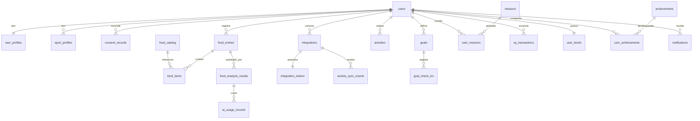

# Desenho do banco de dados

> **Nenhuma migration é criada na Fase 00.** Este é o desenho inicial, que a fase dona de cada tabela confirma ao criá-la. Mudanças relevantes passam por ADR.

PostgreSQL. Versão decidida na [ADR 0002](decisions/0002-technology-baseline.md).

## Convenções

- **Chave primária:** `id` UUID em todas as tabelas com dados de usuário. Assim um identificador não revela volume nem permite enumeração. A geração (v4 ou v7) é decidida na Fase 01.
- **Tempos:** `created_at` e `updated_at` em UTC. Datas "do dia da pessoa" ficam em `local_date`, calculadas com o fuso dela no momento do registro.
- **Identidade entre contextos:** coluna de identificador. Há chave estrangeira real apenas dentro do mesmo contexto e para `users`, onde a exclusão é controlada.
- **Estimativas:** toda grandeza estimada usa colunas `_min`, `_likely` e `_max`, mais `confidence`. Nunca há coluna única que pareça medição.
- **Soft delete:** só onde indicado. O padrão é apagar de verdade, conforme a [política de privacidade](../security/PRIVACY_AND_LGPD.md).
- **Índices:** cada um precisa de uma consulta que o justifique.
- **Exclusão de conta:** um job de Identity percorre o registro compartilhado de apagadores (`shared/data_registry`), no qual cada contexto inscreve o seu `eraser`. A linha de `users` permanece, anonimizada, ao fim do processo.

## Mapa de relacionamentos

## Identity & Access

### `users`

Conta e autenticação.

- **Colunas:** `id`, `email`, `password_digest` (na exclusão, trocado pelo hash de um segredo aleatório que ninguém guarda, sem valor utilizável), `adult_confirmed_at`, `deleted_at`. O pedido de exclusão fica em `account_deletions`.
- **Constraints:** `email` único e sem diferença entre maiúsculas e minúsculas; `adult_confirmed_at NOT NULL`, o que impede criar conta sem a declaração de maioridade. A declaração não comprova a idade.
- **Índices:** único em `lower(email)`.
- **Soft delete:** `deleted_at` marca a conta excluída. Ao final do processo a linha permanece com o mesmo UUID, o e-mail trocado por um valor aleatório (mantém o `NOT NULL` e o índice único), sem senha. `consent_records` e `audit_events` seguem ligados a esse UUID, sem conteúdo de saúde. O mesmo e-mail pode criar outra conta.

### `sessions`

Sessões e tokens renováveis, por dispositivo. A forma exata depende da [ADR 0005](decisions/0005-authentication-strategy.md).

- **Colunas:** `id`, `user_id` (FK), `token_digest`, `device_label`, `expires_at`, `revoked_at`.
- **Índices:** único em `token_digest`; em `user_id` para listar sessões.

### `consent_records`

Histórico de inclusão apenas: nunca atualizado nem apagado enquanto a conta existir.

- **Colunas:** `id`, `user_id` (FK), `purpose`, `text_version`, `action` (`granted` ou `revoked`), `occurred_at`, `source`.
- **Constraints:** `purpose` e `action` validados por `CHECK`.
- **Índices:** `(user_id, purpose, occurred_at DESC)`, para obter o estado atual.

### `audit_events`

Trilha de ações sensíveis, de inclusão apenas.

- **Colunas:** `id`, `user_ref` (UUID do usuário, sem outros dados; na exclusão da conta continua ligado ao mesmo UUID), `action`, `metadata` (lista fechada de campos por `action`, sem texto livre, e-mail digitado ou dado de saúde), `ip_hmac` (HMAC com chave rotativa, pois hash simples de IPv4 é reversível), `occurred_at`.
- **Índices:** `(user_ref, occurred_at)`.

### `account_deletions`

Acompanha a exclusão de conta até a conclusão.

- **Colunas:** `id`, `user_id` (FK), `requested_at`, `pending_contexts` (nomes de contexto do registro, sem texto livre), `completed_at`. O prazo de 24 horas é contado a partir de `requested_at`.
- **Constraints:** único em `user_id`, o que torna o pedido repetido, mesmo simultâneo, inofensivo; `pending_contexts` só com nomes no formato de contexto; `completed_at` só com `pending_contexts` vazio.
- **Índices:** parcial em `requested_at WHERE completed_at IS NULL`, para a rotina horária do prazo.
- **Fluxo:** o pedido revoga as sessões, cria a linha com `pending_contexts` vindo do registro e publica `user.deletion_requested`, na mesma transação. A partir daí a conta não entra, não redefine senha nem consente, e a outbox descarta os eventos da pessoa, exceto `user.deletion_requested`. Um job de Identity (`EraseAccountJob`) percorre os `erasers` do registro compartilhado (`shared/data_registry`), sem que os contextos chamem Identity. Cada apagador concluído sai de `pending_contexts`, e uma falha repete só o que falta. A rotina horária (`DeletionDeadlineJob`) enfileira de novo as exclusões não concluídas e, passadas 24 horas, dispara alerta só com o id da exclusão. A anonimização final de `users` só ocorre com tudo concluído. A linha permanece como registro mínimo (só o UUID e as datas) para reaplicar exclusões após restauração de backup; por isso não é apagada nem exportada.

## User Profile

### `user_profiles`

Dados pessoais e preferências.

- **Colunas:** `user_id` (PK e FK), `display_name`, `time_zone`, `units`, `notification_preferences` (JSONB), `quiet_hours`, `motivations` (lista fechada de 0 a 4 itens, opcional, sem texto livre).
- **Constraints:** `time_zone NOT NULL`.

### `sport_profiles`

Nível por esporte.

- **Colunas:** `id`, `user_id` (FK), `sport`, `level`, `started_at`, `ended_at` (nulo na linha vigente).
- **Histórico:** mudar o nível encerra a linha atual (`ended_at`) e cria outra, preservando o histórico.
- **Constraints:** único em `(user_id, sport)` com `ended_at` nulo; `level` em `beginner`, `intermediate` ou `advanced`.

## Nutrition

### `food_entries`

Uma refeição.

- **Colunas:** `id`, `user_id` (FK), `source` (`photo` ou `manual`), `status` (`pending`, `processing`, `analyzed`, `failed`, `confirmed`), `photo_key`, `meal_at`, `local_date`, `calories_min`, `calories_likely`, `calories_max`, `confirmed_at`, `client_request_id`.
- **Constraints:** `calories_min <= calories_likely <= calories_max` quando preenchidas; único em `(user_id, client_request_id)`, para evitar registro duplicado em nova tentativa; `status` validado por `CHECK`.
- **Índices:** `(user_id, local_date DESC)` para o histórico.
- **Soft delete:** não. Excluir apaga a linha, os itens e a foto.

### `food_items`

Itens de uma refeição.

- **Colunas:** `id`, `food_entry_id` (FK, `ON DELETE CASCADE`), `catalog_item_id` (referência), `display_name`, `quantity_grams_min`, `quantity_grams_likely`, `quantity_grams_max`, `household_measure`, `calories_min`, `calories_likely`, `calories_max`, `protein_g_*`, `carbs_g_*`, `fat_g_*`, `confidence`, `origin` (`ai` ou `user`), `corrected_from_item_id`, `nutrition_source_ref`.
- **Constraints:** faixas ordenadas; `confidence` entre 0 e 1 quando presente; item corrigido pela pessoa mantém `origin = 'user'`.
- **Índices:** `food_entry_id`.

## Food AI

### `food_analysis_results`

Cada execução do pipeline. Não é reescrito enquanto a refeição existir, e `raw_response` é **apagado** ao excluir a refeição ou a conta.

- **Colunas:** `id`, `food_entry_id` (referência), `user_id`, `provider`, `model`, `prompt_version`, `schema_version`, `status`, `raw_response` (JSONB validado), `error_code`, `started_at`, `finished_at`.
- **Índices:** `food_entry_id`; `(prompt_version, status)` para avaliação.
- **Retenção:** ver a tabela de retenção.

### `ai_usage_records`

Custo por chamada.

- **Colunas:** `id`, `analysis_id` (FK), `user_id`, `provider`, `model`, `input_tokens`, `output_tokens`, `cost_usd`, `occurred_at`.
- **Índices:** `(user_id, occurred_at)` para limite e custo por usuário; `occurred_at` para custo total.

### `prompt_versions`

- **Colunas:** `id`, `version`, `schema_version`, `body_ref`, `activated_at`.
- **Constraints:** único em `version`.

## Food Catalog

### `food_catalog`

Referência sem dados pessoais.

- **Colunas:** `id`, `source`, `source_version`, `source_item_id`, `license`, `name`, `name_pt`, `kind` (`ingredient` ou `composition`), `nutrients_per_100g` (JSONB), `search_vector`.
- **Constraints:** único em `(source, source_version, source_item_id)`; `license NOT NULL`, para que nada entre sem licença registrada.
- **Índices:** GIN em `search_vector` para busca.

### `food_compositions`

Receitas-base de pratos próprios.

- **Colunas:** `id`, `catalog_item_id` (FK), `ingredient_catalog_item_id` (FK), `grams_per_100g`, `notes`.
- **Constraints:** único em `(catalog_item_id, ingredient_catalog_item_id)`.

## Activities

### `activities`

- **Colunas:** `id`, `user_id` (FK), `provider` (`manual` ou `strava`), `external_id`, `activity_type`, `started_at`, `local_date`, `duration_seconds`, `distance_meters`, `elevation_meters`, `visibility`, `backfill`, `source_updated_at`, `deleted_at`.
- **Campos de origem externa:** lista permitida. Rota, coordenadas, ponto de partida e título livre não são gravados ([Strava](STRAVA_INTEGRATION.md)).
- **Constraints:** único parcial em `(provider, external_id)` quando `external_id` existe; `duration_seconds >= 0`.
- **Índices:** `(user_id, local_date DESC)`; `(user_id, activity_type, local_date DESC)` para filtros.
- **Soft delete:** breve (`deleted_at`), para estornos e reconciliação. Removida em definitivo pela rotina de retenção. Em desconexão do Strava, a remoção é imediata.

## Strava Integration

### `integrations`

- **Colunas:** `id`, `user_id` (FK), `provider`, `external_account_id`, `granted_scopes`, `status` (`active`, `revoked`, `error`), `backfill_cursor`, `last_reconciled_at`, `connected_at`.
- **Constraints:** único em `(provider, external_account_id)`; único em `(user_id, provider)`.

### `integration_tokens`

Tokens, cifrados em nível de aplicação.

- **Colunas:** `integration_id` (PK e FK, `ON DELETE CASCADE`), `access_token_ciphertext`, `refresh_token_ciphertext`, `expires_at`, `lock_version`.
- **Concorrência:** `lock_version` e bloqueio na renovação, porque o refresh token antigo é invalidado imediatamente pelo Strava.
- **Índices:** `expires_at`, para renovação antecipada.

### `activity_sync_events`

Registro bruto dos eventos recebidos e estado do processamento.

- **Colunas:** `id`, `integration_id` (referência), `provider`, `object_type`, `object_id`, `aspect_type`, `owner_external_id`, `event_time`, `payload` (JSONB), `status`, `attempts`, `processed_at`.
- **Constraints:** único em `(provider, object_type, object_id, aspect_type, event_time)`, para idempotência no recebimento.
- **Índices:** parcial em `status` para os pendentes.

## Goals

### `goals`

- **Colunas:** `id`, `user_id` (FK), `goal_type`, `cadence` (`daily` ou `weekly`), `target`, `rule_version`, `status`, `starts_on`, `ends_on`.
- **Constraints:** `goal_type` em lista fechada, que **não** contém calorias, déficit, peso ou compensação. `CHECK` garante isso no próprio banco.
- **Índices:** `(user_id, status)`.

### `goal_check_ins`

- **Colunas:** `id`, `goal_id` (FK), `user_id`, `local_date`, `source` (`manual`, `activity`, `food_entry`), `source_ref`, `checked_at`.
- **Constraints:** único em `(goal_id, local_date, source, source_ref)`; check-in manual é único por `(goal_id, local_date)`.
- **Índices:** `(user_id, local_date DESC)`.

### `weekly_plans`

Criada na etapa 05.2.

- **Colunas:** `id`, `user_id` (FK), `week_start`, `planned_items` (JSONB), `recovery_days` (`date[]`).
- **Constraints:** único em `(user_id, week_start)`.

## Missions

### `missions`

- **Colunas:** `id`, `code`, `sport`, `level`, `rule_code`, `rule_version`, `xp_reward`, `starts_at`, `ends_at`, `active`.
- **Constraints:** único em `(code, rule_version)`.

### `user_missions`

- **Colunas:** `id`, `user_id` (FK), `mission_id` (FK), `status` (`assigned`, `completed`, `expired`), `assigned_at`, `completed_at`, `period_key`, `completing_event_id`.
- **Constraints:** único em `(user_id, mission_id, period_key)`.
- **Índices:** `(user_id, status)`.

## Gamification

### `xp_transactions`

Livro-razão de inclusão apenas.

- **Colunas:** `id`, `user_id` (FK), `amount` (positivo ou negativo), `kind` (`award` ou `reversal`), `rule_code`, `rule_version`, `source_event_id`, `source_event_name`, `source_entity_type`, `source_entity_id`, `reverses_transaction_id`, `occurred_at`.
- **Constraints:** único em `(user_id, source_event_id, rule_code)`, o que impede concessão duplicada, inclusive depois de mudar a versão da regra; único em `reverses_transaction_id`, o que impede estorno duplicado. Sem `UPDATE` nem `DELETE` por aplicação, salvo exclusão de conta.
- **Índices:** `(user_id, occurred_at DESC)`; `(user_id, source_entity_type, source_entity_id)` para estornos.

### `user_levels`

Projeção recalculável do livro-razão.

- **Colunas:** `user_id` (PK e FK), `total_xp`, `level`, `curve_version`, `lock_version`, `updated_at`.

### `streaks`

- **Colunas:** `id`, `user_id` (FK), `kind`, `current_count`, `best_count`, `last_counted_date`, `tolerance_used`.
- **Constraints:** único em `(user_id, kind)`.

### `achievements`

- **Colunas:** `id`, `code`, `rule_code`, `rule_version`, `active`.
- **Constraints:** único em `code`.

### `gamification_counters` e `planned_recovery_days`

Projeções locais de Gamification, derivadas só de eventos.

- **`gamification_counters`:** `user_id`, `counter_code`, `period_key`, `value`. Único em `(user_id, counter_code, period_key)`. Sustenta tetos, missões como "3 vezes na semana" e conquistas.
- **`planned_recovery_days`:** `user_id`, `local_date`. Único nos dois campos. Impede pontuar atividade em dia de recuperação planejado.

### `user_achievements`

- **Colunas:** `id`, `user_id` (FK), `achievement_id` (FK), `unlocked_at`, `source_event_id`.
- **Constraints:** único em `(user_id, achievement_id)`.

## Notifications

### `notifications`

- **Colunas:** `id`, `user_id` (FK), `kind`, `template`, `params` (JSONB), `dedupe_key`, `delivered_at`, `read_at`.
- **Constraints:** único em `(user_id, dedupe_key)`.
- **Índices:** `(user_id, read_at, created_at DESC)`.

### `device_tokens`

- **Colunas:** `id`, `user_id` (FK), `token_ciphertext`, `token_digest`, `platform`, `revoked_at`.
- **Constraints:** único em `token_digest`.

## Progress & Analytics

### `progress_snapshots` e `weekly_reports`

Projeções reconstruíveis pelas APIs públicas dos contextos de origem, porque eventos expiram. Sem dado que não exista na origem. Dados de origem Strava mantêm `provider` para apagamento seletivo.

- **Colunas de `progress_snapshots`:** `id`, `user_id` (FK), `local_date`, `metrics` (JSONB de constância, sem calorias).

- **Colunas de `weekly_reports`:** `id`, `user_id` (FK), `week_start`, `summary` (JSONB), `generated_at`.
- **Constraints:** único em `(user_id, week_start)`.

### `usage_facts`

Métricas de ativação e retenção, somente com o consentimento `usage_metrics`. Criada no M1.

- **Colunas:** `user_ref`, `fact` (lista fechada), `occurred_on`. Sem conteúdo de refeições.
- **Constraints:** único em `(user_ref, fact, occurred_on)`.

## Infraestrutura de eventos

### `outbox_events`

- **Colunas:** `id`, `name`, `version`, `user_id`, `correlation_id`, `payload` (JSONB), `occurred_at`, `published_at`, `attempts`, `next_attempt_at`, `dead_at`. `next_attempt_at` guarda a espera crescente entre tentativas (1, 2, 4… 64 minutos); na oitava falha, `dead_at`.
- **Constraints:** `CHECK` no formato de `name` (`contexto.fato`), em `version >= 1`, `attempts >= 0` e `payload` como objeto JSON. `user_id` sem chave estrangeira, porque `shared/` não referencia outro contexto.
- **Índices:** parcial em `(occurred_at) WHERE published_at IS NULL AND dead_at IS NULL`, para o publicador e a conferência; em `user_id`, para a exclusão de conta.
- **Registro de dados:** inscrita no `shared/data_registry` pelo contexto `shared`. A exportação devolve vazio, porque o payload só tem IDs; o apagador remove os eventos da pessoa, exceto `user.deletion_requested`.
- **Descarte:** evento cuja regra registrada em `Shared::Outbox.discard_if` responda verdadeiro é apagado sem entrega. `user.deletion_requested` nunca é descartado. Se a regra falhar, o evento não é entregue e a falha conta como tentativa, com o consumidor `outbox.discard_rule` no alerta.
- **Retenção:** apagar os publicados 30 dias depois do processamento. Eventos pendentes e mortos nunca são apagados pela rotina, porque não foram processados: um `consent.revoked` de `health_data` morto continua impedindo um novo consentimento até ser resolvido ([runbook](../operations/RUNBOOK_OUTBOX.md)). Eventos de usuário em exclusão são removidos pelo fluxo de exclusão.

### `consumed_events`

- **Colunas:** `consumer`, `event_id`, `consumed_at`.
- **Constraints:** chave primária em `(consumer, event_id)`, base da idempotência dos consumidores. Chave estrangeira para `outbox_events` com `ON DELETE CASCADE`, com índice em `event_id`.

## Concorrência

| Situação | Controle |
|---|---|
| Duas renovações do mesmo token do Strava | Bloqueio em `integration_tokens` |
| Dois eventos iguais simultâneos | Índices únicos em `activity_sync_events` e `consumed_events` |
| Concessão simultânea de XP | Índice único em `xp_transactions`; atualização de `user_levels` por `lock_version` |
| Conquista desbloqueada duas vezes | Índice único em `user_achievements` |
| Reenvio de foto pelo cliente | Índice único em `client_request_id` |

## Auditoria

- `audit_events` registra ações sensíveis ([SECURITY.md](../security/SECURITY.md)).
- `consent_records` e `xp_transactions` são históricos que não se reescrevem durante a vida da conta. `food_analysis_results` segue a vida da refeição.
- Metadados de auditoria não contêm dados de saúde.

## Retenção

Prazos iniciais, a confirmar com a revisão jurídica ([PRIVACY_AND_LGPD.md](../security/PRIVACY_AND_LGPD.md)). Aplicados por rotina automática.

| Dado | Retenção | Ao excluir a conta |
|---|---|---|
| Fotos | Até a exclusão da refeição ou da conta; prazo máximo decidido na Fase 03. Sem comida detectada: apagadas automaticamente | Apagadas |
| Refeições e itens | Enquanto a conta existir | Apagados |
| `food_analysis_results` | 90 dias; depois, só agregados sem texto livre | Apagados, incluindo `raw_response` |
| `ai_usage_records` | 90 dias com vínculo ao usuário; depois, agregados sem vínculo | Vínculo removido; só contagem e custo |
| Atividades | Enquanto a conta existir e, no caso do Strava, enquanto a integração durar | Apagadas |
| Tokens | Até a desconexão | Apagados |
| `activity_sync_events` | 30 dias | Apagados |
| `outbox_events` e `consumed_events` | 30 dias após a publicação; pendentes e mortos ficam até serem resolvidos | Removidos ou anonimizados |
| XP, metas, missões e conquistas | Enquanto a conta existir | Apagados |
| `consent_records` e `audit_events` | Proposta provisória de 5 anos, a confirmar na revisão jurídica | Mantidos sem conteúdo de saúde, ligados ao mesmo UUID |
| `sessions` e `device_tokens` | Até expirar ou revogar, mais 30 dias | Apagados |
| `notifications` | 90 dias | Apagadas |
| `weekly_reports`, `progress_snapshots`, `weekly_plans` | Enquanto a conta existir | Apagados |
| `usage_facts` | Definida no M1; apagada ao revogar `usage_metrics` | Apagada |
| Backups | Rotação definida no M1 | Expiram com a rotação; a lista de exclusões é reaplicada após qualquer restauração |
