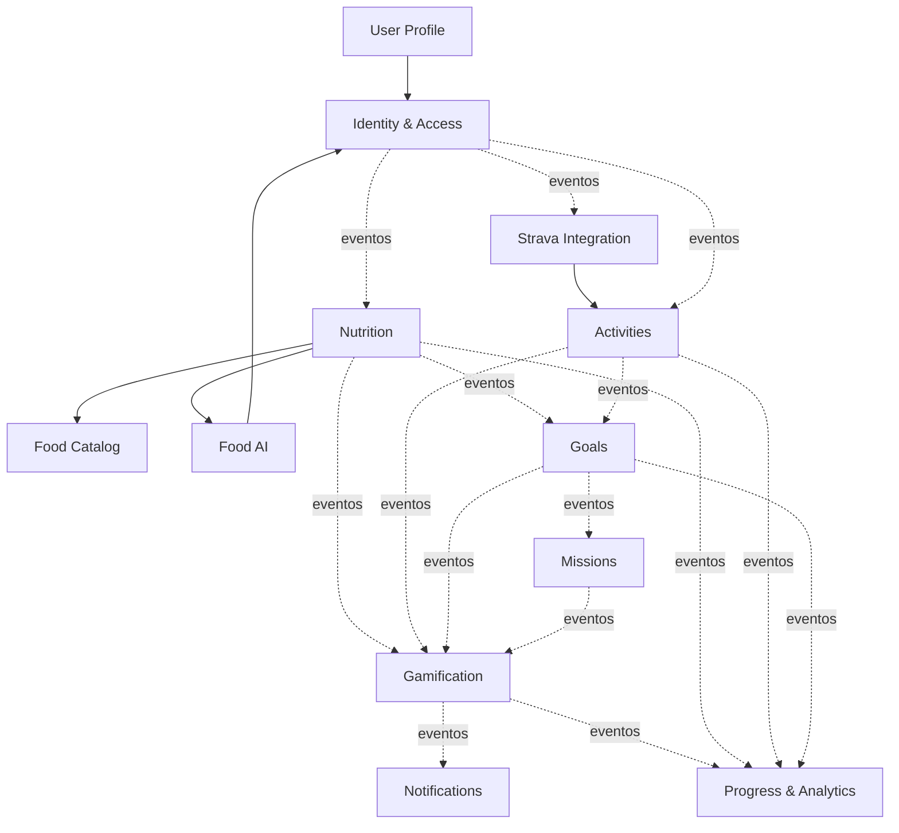

# Modelo de domínio

Doze contextos num só monólito, separados por namespace ([ADR 0003](decisions/0003-domain-boundaries-without-engines.md)). Tabelas em [DATABASE_DESIGN.md](DATABASE_DESIGN.md).

## Regras de dependência

1. Um contexto só chama outro por sua **API pública**: módulos e serviços expostos em `<Contexto>::Api` ou por eventos. A `Api` devolve valores, `Data` ou identificadores, nunca modelos nem consultas do ActiveRecord.
2. Um contexto **nunca** lê ou grava as tabelas de outro, nem usa os modelos de outro em associações. Referência entre contextos é por identificador.
3. Identity & Access é a única dependência permitida a todos, e somente para: usuário atual e `consent_granted?(user_id, purpose)`. Na exclusão de conta, nenhum contexto chama Identity: cada contexto registra seu `exporter` e seu `eraser` em `Shared::DataRegistry` ao iniciar, e Identity executa os apagadores.
4. Nenhum contexto depende de Gamification, Notifications ou Progress & Analytics. Gamification só escuta eventos. Notifications escuta eventos e lê preferências em User Profile. Progress & Analytics escuta eventos e pode ler as APIs públicas dos demais, em sentido único.
5. Ciclos são proibidos. Quando a informação precisa voltar, usa-se evento.
6. Infraestrutura (cliente de IA, cliente do Strava, armazenamento) fica atrás de adaptadores de cada contexto.
7. `UserProfile::Api.time_zone(user_id)` pode ser lido por Nutrition, Activities, Goals e Missions, para calcular `local_date`.
8. Exportação e exclusão usam um registro compartilhado em `shared/`: cada contexto com dados de usuário inscreve seu exportador e seu apagador. Identity aciona o registro sem conhecer o conteúdo, e a exportação é montada na hora, em memória, sem gravar arquivo. `shared/` contém também a infraestrutura de eventos e não tem regra de negócio. Exceção aceita (rulings R3 e R4): `shared/` conhece um único nome de evento de Identity, `user.deletion_requested`, que a regra de descarte da outbox nunca descarta.

O teste que impõe isso, e o que ele não alcança, estão na [ADR 0003](decisions/0003-domain-boundaries-without-engines.md). As dependências permitidas ficam em `apps/api/config/domain_boundaries.yml`.

## Mapa de dependências

Setas contínuas mostram as principais chamadas síncronas permitidas; a lista completa está nas seções "Permitido" e em `apps/api/config/domain_boundaries.yml`. Setas tracejadas são eventos. `user.deletion_requested` não tem consumidor hoje: a exclusão chega a todos os contextos pelo registro de dados, e o evento fica para efeitos fora do banco que um contexto venha a precisar.

## Contextos

### 1. Identity & Access

- **Responsabilidade:** contas, autenticação, sessões, autorização base, consentimentos e exclusão de conta.
- **Modelos:** `User`, `Session`, `ConsentRecord`, `AuditEvent`, `AccountDeletion`.
- **Serviços:** `Register`, `Authenticate`, `RevokeSession`, `GrantConsent`, `RevokeConsent`, `RequestDeletion`, `ExportAccount`, e o job `EraseAccountJob`, que percorre o registro de dados.
- **Publica:** `user.registered`, `consent.granted`, `consent.revoked`.
- **Consome:** nada.
- **Registra no registro de dados** (`Shared::DataRegistry`): as tabelas `users`, `sessions`, `consent_records`, `audit_events`, `account_deletions`, com exportador e apagador. Registra também a regra de descarte da outbox: evento de usuário com exclusão pedida (`account_deletions` existe) é descartado, exceto `user.deletion_requested`.
- **Permitido:** nenhum outro contexto.
- **Proibido:** conhecer dados de saúde. Exportação e exclusão passam pelo registro da regra 8.

### 2. User Profile

- **Responsabilidade:** dados pessoais, preferências e perfil esportivo por esporte.
- **Modelos:** `Profile`, `SportProfile`.
- **Serviços:** `UpdateProfile`, `SetSportLevel`.
- **Publica:** `sport_profile.changed`.
- **Consome:** `user.registered` (consumidor `user_profile.create_profile`, cria o perfil com o fuso do cadastro) e `consent.revoked` (consumidor `user_profile.erase_health_data`, quando a finalidade é `health_data`: apaga esportes, motivações e nome de exibição e mantém fuso e unidades). A exclusão de conta chega pelo registro de dados, não por evento.
- **Registra no registro de dados:** `user_profiles` e `sport_profiles`.
- **Permitido:** Identity & Access.
- **Proibido:** guardar peso, medidas ou metas corporais.

### 3. Nutrition

- **Responsabilidade:** refeições, itens, confirmação, correção, cálculo em faixa e histórico.
- **Modelos:** `FoodEntry`, `FoodItem`.
- **Serviços:** `ConfirmFoodEntry`, `CorrectFoodItem`, `CreateManualFoodEntry`, `DeleteFoodEntry`, `NutritionCalculator`.
- **Publica:** `food_entry.created`, `food_entry.confirmed`, `food_entry.corrected`, `food_entry.deleted`.
- **Consome:** `food_analysis.completed`, `food_analysis.failed`.
- **Permitido:** API pública de Food AI, de Food Catalog e o fuso de User Profile.
- **Proibido:** conhecer provedor de IA; expor limite ou meta de calorias.

### 4. Food AI

- **Responsabilidade:** autorização de envio, visão computacional (itens e porções validados), adaptadores de provedor, prompts versionados, avaliação e custo. Termina ao publicar `food_analysis.completed`.
- **Modelos:** `FoodAnalysisResult`, `AiUsageRecord`, `PromptVersion`.
- **Serviços:** `AuthorizeUpload`, `AnalyzeFoodPhoto`, `ProviderAdapter` (interface), `RecordAiUsage`, `CheckAnalysisQuota`.
- **Publica:** `food_analysis.completed`, `food_analysis.failed`.
- **Consome:** `consent.revoked`.
- **Permitido:** Identity & Access (consentimento).
- **Proibido:** gravar em `food_entries`; calcular nutrição; receber dados do Strava.

### 5. Food Catalog

- **Responsabilidade:** alimentos, composições próprias, origem, versão e licença. Adaptadores de base nutricional.
- **Modelos:** `FoodCatalogItem`, `FoodComposition`.
- **Serviços:** `SearchFoods`, `NutrientsFor`, `ImportSource`.
- **Publica:** nada.
- **Consome:** nada.
- **Permitido:** nenhum outro contexto.
- **Proibido:** dados de usuário. É referência compartilhada e sem dados pessoais.

### 6. Activities

- **Responsabilidade:** atividades de qualquer origem, sem duplicar, com histórico.
- **Modelos:** `Activity`.
- **Serviços:** `RecordManualActivity`, `UpsertExternalActivity`, `DeleteActivity`.
- **Publica:** `activity.imported`, `activity.updated`, `activity.deleted`.
- **Consome:** nada.
- **Permitido:** Identity & Access e o fuso de User Profile.
- **Proibido:** conhecer detalhes do Strava além de `provider` e `external_id`.

### 7. Strava Integration

- **Responsabilidade:** OAuth, tokens, webhook, sincronização, reconciliação, limites e desconexão.
- **Modelos:** `Integration`, `IntegrationToken`, `ActivitySyncEvent`.
- **Serviços:** `ConnectStrava`, `RefreshToken`, `ReceiveWebhookEvent`, `ProcessWebhookEvent`, `BackfillActivities`, `ReconcileActivities`, `DisconnectStrava`, `RateLimitBudget`.
- **Publica:** `integration.connected`, `integration.disconnected`.
- **Consome:** `consent.revoked` (finalidade `strava_integration`, dispara a desconexão).
- **Permitido:** API pública de Activities e Identity & Access (consentimento).
- **Proibido:** expor dados de um atleta a outro; enviar dados a provedores de IA.

### 8. Goals

- **Responsabilidade:** metas de hábito, check-ins, regras de conclusão, planejamento semanal e recuperação.
- **Modelos:** `Goal`, `GoalCheckIn`, `WeeklyPlan`.
- **Serviços:** `CreateGoal`, `CheckIn`, `EvaluateGoal`, `PlanWeek`.
- **Publica:** `goal.created`, `goal.progressed`, `goal.completed`, `goal.uncompleted`, `recovery_day.planned`, `recovery_day.logged`.
- **Consome:** `food_entry.confirmed`, `food_entry.deleted`, `activity.imported`, `activity.deleted`, `sport_profile.changed`.
- **Permitido:** API pública de User Profile para sugestão de metas.
- **Proibido:** tipos de meta baseados em calorias, déficit, peso ou compensação.

### 9. Missions

- **Responsabilidade:** catálogo de missões, atribuição por perfil, ciclo de vida e desafios.
- **Modelos:** `Mission`, `UserMission`.
- **Serviços:** `AssignMissions`, `EvaluateMission`.
- **Publica:** `mission.assigned`, `mission.completed`.
- **Consome:** `food_entry.confirmed`, `activity.imported`, `goal.completed`, `recovery_day.logged`, `sport_profile.changed`.
- **Permitido:** API pública de User Profile.
- **Proibido:** conceder XP diretamente.

### 10. Gamification

- **Responsabilidade:** XP, níveis, conquistas, sequências e recompensas virtuais.
- **Modelos:** `XpTransaction`, `UserLevel`, `Achievement`, `UserAchievement`, `Streak`, `GamificationCounter`, `PlannedRecoveryDay`.
- **Serviços:** `RuleRegistry` (regras em classes Ruby versionadas), `AwardXp`, `ReverseXp`, `RecalculateLevel`, `UnlockAchievement`, `UpdateStreak`.
- **Publica:** `xp.awarded`, `xp.reversed`, `level.unlocked`, `achievement.unlocked`.
- **Consome:** `food_entry.confirmed`, `food_entry.deleted`, `activity.imported`, `activity.deleted`, `goal.completed`, `goal.uncompleted`, `mission.completed`, `recovery_day.planned`, `recovery_day.logged`.
- **Permitido:** nenhum contexto de forma síncrona.
- **Proibido:** ler tabelas de Nutrition ou de Activities; usar calorias, déficit, peso, duração, distância ou volume absoluto em regras. Os eventos não carregam esses campos ([ADR 0009](decisions/0009-gamification-safety-principles.md)).

### 11. Notifications

- **Responsabilidade:** preferências de entrega, caixa de mensagens, push e horário de silêncio.
- **Modelos:** `Notification`, `DeviceToken`.
- **Serviços:** `Notify`, `DeliverPush`.
- **Publica:** nada.
- **Consome:** `mission.assigned`, `achievement.unlocked`, `level.unlocked`, `report.generated`.
- **Permitido:** API pública de User Profile para preferências.
- **Proibido:** gerar texto fora da lista de linguagem aprovada.

### 12. Progress & Analytics

- **Responsabilidade:** evolução, relatórios semanais, insights e, de forma separada, métricas de produto, estas só com o consentimento `usage_metrics`.
- **Modelos:** `ProgressSnapshot`, `WeeklyReport`, `UsageFact`.
- **Serviços:** `BuildWeeklyReport`, `ComputeConsistency`, `GenerateInsight`.
- **Publica:** `report.generated`.
- **Consome:** `user.registered`, `consent.revoked`, eventos de Nutrition, Activities, Goals, Missions e Gamification. Eventos servem de gatilho.
- **Permitido:** leitura das APIs públicas de Identity & Access, User Profile, Nutrition, Activities, Goals e Missions. Projeções podem ser reconstruídas por essas APIs. Food AI e Strava Integration ficam de fora, porque dados do Strava não podem chegar a um provedor de IA ([ADR 0003](decisions/0003-domain-boundaries-without-engines.md)).
- **Proibido:** diagnóstico; inferências sobre saúde; enviar dados do Strava à IA; expor dados entre usuários.

## Eventos de domínio

**Formato:** `{ id, name, version, occurred_at, user_id, correlation_id, payload }`. Nome em passado, em inglês. O `id` é único e serve de chave de idempotência dos consumidores.

| Evento | Produtor | Conteúdo mínimo do payload | Consumidores |
|---|---|---|---|
| `user.registered` | Identity & Access | `time_zone` | User Profile, Progress & Analytics |
| `user.deletion_requested` | Identity & Access | vazio | nenhum hoje (a exclusão usa o registro de dados) |
| `consent.granted` / `consent.revoked` | Identity & Access | finalidade, versão | User Profile (só `consent.revoked`), Food AI, Strava Integration, Progress & Analytics |
| `sport_profile.changed` | User Profile | `sport_profile_id`, tipo da mudança (esporte e nível são dado de saúde: o consumidor lê pela `UserProfile::Api`) | Goals, Missions |
| `food_entry.created` | Nutrition | `food_entry_id`, origem | Progress & Analytics |
| `food_analysis.completed` / `food_analysis.failed` | Food AI | `analysis_id`, `food_entry_id` (itens e porções ficam na API de Food AI) | Nutrition |
| `food_entry.confirmed` | Nutrition | `food_entry_id`, data local | Goals, Missions, Gamification, Progress & Analytics |
| `food_entry.corrected` | Nutrition | `food_entry_id` | Progress & Analytics |
| `food_entry.deleted` | Nutrition | `food_entry_id` | Goals, Gamification, Progress & Analytics |
| `activity.imported` / `activity.updated` | Activities | `activity_id`, tipo, data local, origem, `backfill` | Goals, Missions, Gamification, Progress & Analytics |
| `activity.deleted` | Activities | `activity_id` | Goals, Gamification, Progress & Analytics |
| `integration.connected` / `integration.disconnected` | Strava Integration | provedor | Progress & Analytics |
| `goal.created` / `goal.progressed` | Goals | `goal_id`, tipo | Progress & Analytics |
| `goal.completed` | Goals | `goal_id`, tipo, data local, `period_key` | Missions, Gamification, Progress & Analytics |
| `goal.uncompleted` | Goals | `goal_id`, `period_key` | Gamification, Progress & Analytics |
| `recovery_day.planned` | Goals | data local | Gamification |
| `recovery_day.logged` | Goals | data local | Missions, Gamification, Progress & Analytics |
| `mission.assigned` | Missions | `mission_id`, código da recompensa | Notifications |
| `mission.completed` | Missions | `user_mission_id`, código da recompensa, data local | Gamification, Progress & Analytics |
| `xp.awarded` / `xp.reversed` | Gamification | valor, regra, origem | Progress & Analytics |
| `level.unlocked` / `achievement.unlocked` | Gamification | nível ou conquista | Notifications, Progress & Analytics |
| `report.generated` | Progress & Analytics | `report_id` | Notifications |

**Nenhum evento carrega** calorias, macronutrientes, peso, duração ou distância. Quem precisa de detalhes e tem permissão consulta a API pública do contexto. `food_entry.confirmed` informa que houve confirmação, não o que foi comido.

## Registro de dados

`Shared::DataRegistry` (em `apps/api/app/domains/shared`) é o único ponto de exportação e exclusão de conta. Cada contexto registra, no boot, as tabelas com dado de usuário, um exportador e um apagador; `outbox_events` é registrada por `shared`. Testes (`data_registry_coverage_spec.rb`) falham se existir tabela com dado de usuário sem registro, ou contexto sem exportador. Contexto novo precisa se registrar.

## Entrega, ordem e idempotência

- **Publicação:** todo evento da tabela acima é gravado em `outbox_events` na mesma transação da mudança. Um job publica os pendentes ([ADR 0004](decisions/0004-domain-events-transactional-outbox.md)). A decisão e as regras dos consumidores estão na ADR 0004.
- **Entrega:** pelo menos uma vez. Sem garantia de ordem global, porque a API é assíncrona. Consumidores usam `occurred_at` e consultam a API pública quando a ordem importa.
- **Idempotência:** cada consumidor registra `(consumer, event_id)` numa tabela com índice único, na mesma transação do efeito. Evento repetido é ignorado.
- **Falhas:** retentativas com espera crescente. Após o limite (8), o evento fica marcado como morto e dispara alerta. A rotina de limpeza nunca o apaga. Procedimento de reprocessamento em [RUNBOOK_OUTBOX.md](../operations/RUNBOOK_OUTBOX.md). Enquanto um `consent.revoked` de `health_data` está morto, um novo consentimento de `health_data` responde `409 revocation_pending`. Uma conferência periódica compara eventos publicados, consumidores esperados e `consumed_events`, com alerta por consumidor.
- **Fora de ordem:** quem recebe uma exclusão antes da criação grava um marcador por entidade e ignora a concessão posterior. Eventos de usuário com exclusão pedida são descartados na entrega, exceto `user.deletion_requested`; o consumidor também é idempotente.
- **Versão:** mudança incompatível de payload incrementa `version`, e os consumidores passam a aceitar as duas durante a transição.
