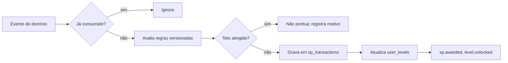

# Arquitetura de gamificação

Motor independente, que só escuta eventos. Implementação na [Fase 06](../roadmap/phases/PHASE_06_GAMIFICATION.md). Princípios na [ADR 0009](decisions/0009-gamification-safety-principles.md).

## Princípios

1. **Premia o sustentável:** constância, registro, recuperação, cumprir o combinado consigo.
2. **Justo entre níveis:** premia cumprir o que faz sentido para o perfil, não volume absoluto.
3. **Auditável:** cada ponto tem origem e regra. O saldo é reconstruível.
4. **À prova de repetição:** o mesmo evento nunca gera XP duas vezes.
5. **Sem dado proibido:** os critérios abaixo não chegam a este contexto nem podem ser usados em regras.

## Critérios proibidos

Nenhuma regra de XP, missão, conquista, desafio ou sequência pode usar ou recompensar:

- Calorias consumidas ou queimadas, déficit ou superávit calórico.
- Peso, medidas, percentual de gordura ou perda de peso.
- Refeições evitadas, jejum ou "dia limpo".
- Volume absoluto de exercício, duração ou distância.
- Treinar em dia de recuperação planejado ou sequência sem descanso.
- Compensar comida com exercício.

### Como isso é imposto

| Camada | Mecanismo |
|---|---|
| Dados | Eventos consumidos não trazem calorias, macronutrientes, peso, duração nem distância |
| Regras | Regras são classes Ruby versionadas num registro, recebendo só um objeto de fatos com lista fechada de campos. Um motor de regras em dados exigiria ADR |
| Teste | Teste automático percorre todas as regras e reprova critério proibido (FR-GAME-010) |
| Banco | Sem colunas com esses dados nas tabelas deste contexto |

## Como o XP é gerado

Tudo ocorre em uma transação, com o registro em `consumed_events`.

### Regras iniciais

São uma proposta, calibrada na Fase 06. Valores são pontos, sem relação com calorias.

| Regra | Evento | XP | Limite |
|---|---|---|---|
| `meal_logged` | `food_entry.confirmed` | 5 | 1 por dia, qualquer que seja o número de registros |
| `goal_completed` | `goal.completed` | 15 | Por meta, por período |
| `activity_session` | `activity.imported` | 20 | 1 por dia, no máximo 5 por semana; não pontua em dia de recuperação planejado nem com `backfill` |
| `recovery_day` | `recovery_day.logged` | 10 | Só dias planejados, no máximo 2 por semana; não soma com atividade no mesmo dia |
| `mission_completed` | `mission.completed` | `missions.xp_reward` | 1 por missão e período |

Observações:

- `meal_logged` premia **cuidar do registro no dia**, com pontuação única. Comer mais ou menos, ou registrar mais vezes, não muda nada. A revisão por profissional de saúde confirma se pontuar registro alimentar é adequado.
- `activity_session` não varia com distância ou duração. Os 20 minutos e os 15 km valem o mesmo.
- O teto limita o ganho sem punir: acima dele, a atividade continua registrada e nada é tirado (FR-GAME-008). Com no máximo 5 sessões pontuadas, treinar todos os dias não rende mais.
- Os valores são proposta, calibrada na Fase 06, sem nunca afrouxar esses limites sem ADR.

## Como os níveis evoluem

- O nível é derivado do XP total, com uma curva versionada. Proposta: `xp_para_nivel(n) = 100 × n × (n - 1) / 2`, ajustada com dados de uso.
- `user_levels` é uma projeção que pode ser recalculada a partir de `xp_transactions` (FR-GAME-003).
- Mudar a curva incrementa `curve_version`, recalcula e nunca baixa o nível exibido de quem já chegou lá.
- Nível de jogo é diferente de nível de experiência esportiva. Os dois não se misturam na interface.

## Como as missões são criadas

- Missões ficam em catálogo versionado (`missions`), com esporte, nível de experiência, período, regra (`rule_code`, classe versionada) e `xp_reward`.
- `AssignMissions` roda semanalmente e ao mudar o perfil esportivo, escolhendo missões conforme esporte e nível (FR-GAME-004).
- Exemplo para iniciante em caminhada: "caminhar 3 vezes nesta semana". Exemplo para avançado em corrida: "cumprir o plano e respeitar o dia de recuperação".
- Toda missão nova passa pelo mesmo teste de critérios proibidos.
- O limite de missões simultâneas evita pressão.

## Como a conclusão é validada

- Somente a partir de eventos no servidor. Não existe rota para o cliente declarar conclusão (FR-GAME-005).
- `EvaluateMission` é uma função determinística sobre fatos derivados de eventos: as mesmas entradas dão o mesmo resultado.
- `completing_event_id` registra o evento que concluiu.
- Índice único em `(user_id, mission_id, period_key)` impede atribuição e conclusão duplicadas.

## Como as conquistas são desbloqueadas

- Regras versionadas sobre contadores e sequências, como "primeira semana com dia de recuperação planejado" ou "quatro semanas de constância". Conquistas não exigem registro alimentar diário prolongado, para não reforçar automonitoramento.
- `user_achievements` é único por pessoa e conquista (FR-GAME-006).
- Conquistas não exigem superar limites físicos ou volume crescente.
- Uma vez desbloqueada, permanece, mesmo se um evento de origem for estornado depois.

## Sequências de consistência

- Contam dias com cuidado registrado: refeição, meta, atividade ou recuperação planejada.
- **Recuperação conta a favor** (FR-GAME-007).
- **Tolerância:** um número limitado de dias perdidos por período não zera a sequência. Proposta: 1 por semana.
- Ao perder de fato, a mensagem convida a retomar, sem destacar a perda nem pressionar com o recorde.
- Calculada no fuso horário da pessoa, a partir de `local_date`, sem efeito de mudança de fuso.

## Como impedir XP duplicado

| Risco | Proteção |
|---|---|
| Evento entregue de novo | `consumed_events` com chave `(consumer, event_id)` |
| Dois workers simultâneos | Índice único em `xp_transactions (user_id, source_event_id, rule_code)` |
| Reprocessamento depois de mudar regra | A chave não inclui a versão, então o mesmo evento não pontua de novo. Recálculo completo é operação explícita, com estornos, nunca automática |
| Atividade reimportada | Mesmo `activity.imported` não se repete por causa do upsert; `activity.updated` não pontua |
| Estorno duplicado | Índice único em `reverses_transaction_id` |

A proteção final está no banco. Um teste de concorrência é obrigatório (Fase 06).

## Histórico de recompensas

- `xp_transactions` é de inclusão apenas. A pessoa vê cada lançamento e seu motivo, como "Registrou o almoço, +5 XP" (FR-GAME-011).
- **Estorno:** excluir a origem gera lançamento negativo que aponta para o original, localizado por `source_entity_type` e `source_entity_id` (FR-GAME-009). Se a exclusão chegar antes da concessão, um marcador por entidade impede a concessão. A interface não apresenta isso como perda. O caso de desconexão do Strava está na [ADR 0017](decisions/0017-derived-data-after-source-removal.md).
- **Metas:** `goal.uncompleted` estorna o XP da meta. **Missão concluída não é revertida**, porque um registro apagado não deve parecer punição.
- O saldo nunca fica negativo na apresentação.
- Na exclusão de conta, o histórico é apagado junto.

## Consistência entre eventos e pontuação

- A outbox garante que o evento existe se a mudança foi gravada, e vice-versa.
- Entrega pelo menos uma vez, com idempotência no consumidor, garante consistência eventual.
- **Conferência:** um job periódico compara a soma de `xp_transactions` com `user_levels.total_xp`, corrige a projeção e alerta sobre divergências.
- **Atraso:** a interface pode mostrar XP alguns segundos depois da ação. O retorno visual vem do `xp.awarded`, sem cálculo no cliente.

## Tratamento de dados na apresentação

- Sem ranking nem comparação com outras pessoas ([ADR 0013](decisions/0013-sport-ranking.md)).
- Se o ranking vier um dia, XP originado de atividades do Strava não poderá ser exibido a terceiros sem revisão, pois pode revelar dados do Strava.
- Mensagens seguem a linguagem de [segurança de dados de saúde](../security/HEALTH_DATA_SAFETY.md): sem culpa, sem urgência e sem medo de perder.
