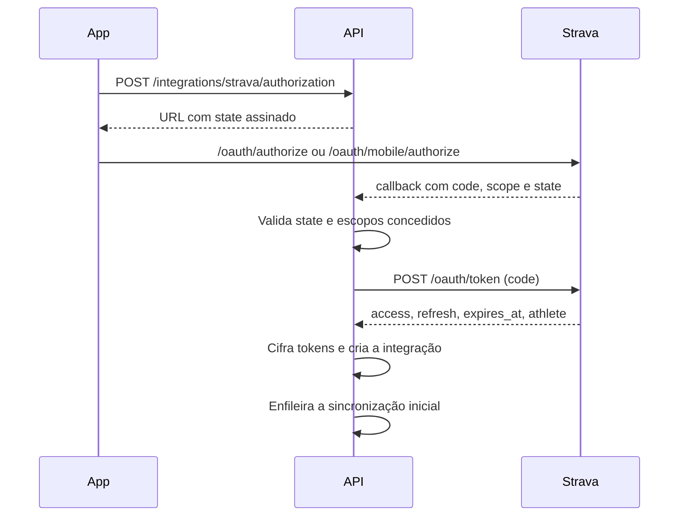

# Integração com o Strava

Integração oficial pela API v3, sem scraping. Implementação na [Fase 04](../roadmap/phases/PHASE_04_STRAVA.md). Limites legais na [ADR 0008](decisions/0008-strava-data-boundaries.md). Os fatos vêm do [registro de fontes](EXTERNAL_SOURCES.md), consultado em 2026-11-05. **A Fase 04 confere a documentação de novo antes de implementar.**

## Limites que moldam o desenho

| Limite do Strava | Consequência aqui |
|---|---|
| Dados de um usuário só podem ser exibidos a esse usuário | Nenhuma tela, relatório ou ranking mostra dados do Strava a outra pessoa |
| Proibido competir ou replicar a funcionalidade do Strava | Sem feed, segmentos, comentários ou social. Atividades servem à evolução pessoal |
| App novo aceita 1 atleta; 10 com upgrade; acima disso, revisão sem garantia | Beta sem Strava; planejar o pedido de revisão; recusar a conexão com mensagem clara ao atingir a capacidade |
| Limite padrão de leitura: 100 a cada 15 min e 1.000 por dia | Sincronização inicial em lotes; webhooks em vez de polling |
| Encerrar exige apagar tudo e certificar por escrito | Rotina de apagamento total testada |
| Acesso não autorizado a token exige aviso em 24 horas | Incluído na [resposta a incidentes](../security/SECURITY.md) |
| Nome do app não pode conter "Strava" | Vale para a marca futura |

## Pré-requisitos do responsável

- Assinatura do Strava, exigida para criar a aplicação.
- Aplicação criada no painel, com domínio de callback configurado (`localhost` é permitido em desenvolvimento).
- Uma aplicação por token: não reutilizar credenciais entre aplicações.

## OAuth 2.0

- `state` é assinado, de uso único e ligado ao usuário, para impedir CSRF.
- O `code` é de uso único e de vida curta, então a troca ocorre imediatamente.
- O segredo da aplicação só existe no backend.
- Mobile usa `/oauth/mobile/authorize`, com a URL de retorno concluindo no backend.

### Escopos

| Escopo | Decisão | Motivo |
|---|---|---|
| `activity:read` | **Pedido** | Mínimo e exigido para webhooks de atividade |
| `activity:read_all` | Não pedido inicialmente | Inclui atividades "Only You" e dados de zona de privacidade. Só com justificativa em ADR |
| `profile:read_all`, `profile:write`, `activity:write` | Não pedidos | Sem necessidade: nada é escrito no Strava |

O atleta pode desmarcar escopos, então o valor retornado em `scope` é sempre verificado. Sem `activity:read`, a conexão não é concluída, e o app explica o motivo.

Com apenas `activity:read`, mudar uma atividade de/para "Only You" chega como exclusão ou criação. O fluxo trata isso sem casos especiais.

## Tokens

- **Armazenamento:** `integration_tokens`, cifrados em nível de aplicação, com chave fora do banco.
- **Duração:** access token expira em 6 horas.
- **Renovação:** antes de chamar a API, se faltar pouco para expirar. Com mais de 1 hora restante, o Strava devolve o token atual.
- **Rotação:** cada renovação pode trazer novo refresh token, e **o anterior é invalidado imediatamente**. Portanto:
  - A renovação acontece sob bloqueio por integração.
  - O novo par é salvo numa transação antes de qualquer uso.
  - Uma falha entre a resposta e o salvamento é o pior caso: a integração passa a `error` e pede reconexão.
- **Revogado (401 confirmado):** tratar como revogação, com o apagamento da desconexão. O estado `error` tem prazo curto, definido na Fase 04, sem reter dados indefinidamente.
- **Logs:** nunca contêm tokens nem o segredo.

## Webhook

Uma única assinatura por aplicação, que cobre todos os atletas.

### Criação e validação

1. Assinatura criada por tarefa operacional, com `POST /api/v3/push_subscriptions`, usando `client_id`, `client_secret`, `callback_url` (até 255 caracteres) e `verify_token`.
2. O Strava faz `GET` no callback com `hub.mode`, `hub.challenge` e `hub.verify_token`.
3. O endpoint compara o `verify_token` e responde em até 2 segundos, com status 200, `application/json` e `{ "hub.challenge": "<valor>" }`.
4. Assinatura só é recriada se necessário. Uma verificação periódica confirma que continua ativa.

### Recebimento

- Grava o evento bruto em `activity_sync_events`, enfileira e responde 200 **em até 2 segundos**.
- O índice único no evento torna a entrega repetida inofensiva. O Strava faz até 3 tentativas.
- O endpoint não faz chamada externa.
- O `POST` não traz assinatura documentada, então **o evento é só um gatilho**. `subscription_id` é conferido antes de gravar, e toda ação é confirmada na API, com o token do atleta (NFR-SEC-007). Avaliar na Fase 04 um segredo no caminho do callback.
- O endpoint fica protegido por limite de requisições.

### Processamento

| Evento | Ação |
|---|---|
| `activity` / `create` | Busca a atividade e faz upsert por `(provider, external_id)`; emite `activity.imported` |
| `activity` / `update` | Busca e atualiza se `event_time` for mais novo; emite `activity.updated` |
| `activity` / `delete` | **Confirma com `GET` individual (404)**, depois remove e emite `activity.deleted`, que estorna XP e recalcula metas |
| Com `updates.authorized = "false"` | **Confirma com uma chamada usando o token guardado (401)**, depois faz o mesmo apagamento da desconexão |
| Atleta sem integração ativa | Marca como ignorado |

Uma mesma alteração pode gerar vários eventos de atualização, de forma assíncrona. Por isso, o processamento agrupa eventos do mesmo objeto.

> A página de webhooks informa `updates` com `authorized: "false"`, mas não declara `object_type` e `aspect_type` desse evento. O código deve identificá-lo pelo campo `updates`, e a Fase 04 confirma o formato real.

## Campos importados

Lista permitida: tipo, início, duração, distância, elevação, visibilidade e identificador. **Rota, coordenadas, ponto de partida, título livre e dados de dispositivo não são gravados nem registrados em logs**, porque revelam endereço e rotina. Ampliar a lista exige justificativa no plano da fase. A referência completa da API é relida na Fase 04.

## Sincronização inicial

- Roda em segundo plano, com cursor salvo em `integrations.backfill_cursor`, retomável após falha.
- Lista de atividades em lotes, do mais recente para o mais antigo, respeitando `RateLimitBudget`.
- Período inicial limitado, a ser definido na Fase 04 (proposta: 90 dias), para caber no orçamento diário.
- Importação não concede XP retroativo de forma que distorça a evolução: atividades importadas nessa fase são marcadas como `backfill`, e as regras decidem a respeito.
- A tela mostra o progresso, e o app segue utilizável.

## Limites de requisição

| Grupo | Padrão | Com upgrade |
|---|---|---|
| Geral | 200 a cada 15 min; 2.000 por dia | 400 a cada 15 min; 4.000 por dia |
| Leitura | 100 a cada 15 min; 1.000 por dia | 200 a cada 15 min; 2.000 por dia |

Janelas reiniciam em 0, 15, 30 e 45 minutos. O dia reinicia à meia-noite UTC.

`RateLimitBudget`:

- Lê `X-RateLimit-*` e `X-ReadRateLimit-*` de cada resposta e guarda no Redis.
- **Prioridade:** webhooks recentes, depois reconciliação, depois sincronização inicial.
- Reserva uma parte da janela para webhooks.
- Ao receber 429, adia até a próxima janela. A documentação não informa `Retry-After`, e o excesso também conta para o limite diário.

## Idempotência

| Camada | Mecanismo |
|---|---|
| Recebimento | Índice único em `activity_sync_events` |
| Atividade | Índice único em `(provider, external_id)` |
| Eventos de domínio | `consumed_events` |
| XP | Índice único em `xp_transactions` |

## Reconciliação

Job diário, por integração ativa e com orçamento baixo:

- Compara as atividades recentes (proposta: 7 dias) com as locais.
- Importa as que faltam e corrige as divergentes.
- Registra as diferenças em métrica. Um número alto indica problema no webhook.
- Remoções só valem quando a atividade retorna 404 numa consulta individual, nunca por ausência na listagem, que depende de visibilidade.

## Desconexão e exclusão

1. **Pela pessoa:** `DisconnectStrava` chama `POST /oauth/revoke`, com autenticação básica da aplicação.
2. **Pelo Strava:** evento com `authorized: "false"` dispara o mesmo fluxo, sem a chamada.
3. **Pela exclusão de conta:** `user.deletion_requested` dispara o fluxo.
4. **Pela revogação de consentimento:** `consent.revoked` da finalidade `strava_integration` dispara o fluxo.

Em todos os casos: **revogar primeiro**, depois apagar tokens, atividades importadas, eventos brutos e eventos relacionados na outbox. Se a revogação falhar, os dados locais são apagados mesmo assim, e o token cifrado vai para uma fila de revogação de vida curta, com auditoria e aviso se esgotar as tentativas. O destino de XP e metas derivados está na [ADR 0017](decisions/0017-derived-data-after-source-removal.md), proposta.

> O endpoint legado `/oauth/deauthorize` deixa de ser aceito em 2027-06-01. Usar somente `/oauth/revoke`.

**Encerramento da aplicação:** apagar todos os dados de todos os atletas e certificar por escrito, conforme o termo de API. O procedimento fica em [RELEASE_CHECKLIST.md](../operations/RELEASE_CHECKLIST.md).

## Marca e apresentação

- Conexão com o botão oficial "Connect with Strava", na altura e cores definidas nas diretrizes.
- Atividades com o link "View on Strava", legível e identificável como link.
- "Powered by Strava" ou "Compatible with Strava" ao mencionar a integração.
- Nunca sugerir patrocínio nem modificar os logotipos.
- O Strava pede fortemente atribuição quando os dados vêm de um dispositivo Garmin. A Fase 04 confirma o que aplicar.

## Questões em aberto para a Fase 04

| Questão | Como resolver |
|---|---|
| Formato real do evento de revogação | Teste com a aplicação em modo de um atleta |
| O termo não menciona IA | Manter a proibição conservadora. Consultar o Strava antes de mudar |
| Definição do que é "replicar" | Revisar as telas contra o termo antes de pedir a revisão |
| Critério de aprovação além de 10 atletas | Enviar o formulário com capturas de tela, sem assumir aprovação |
| Dados e campos da atividade | Reler a referência completa da API, lida apenas em parte |
