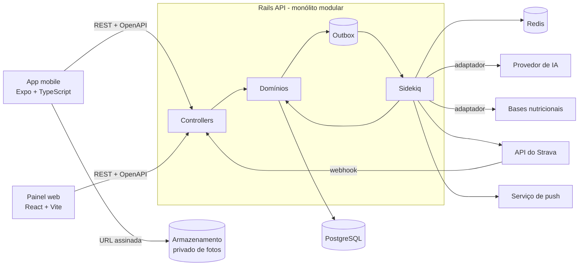
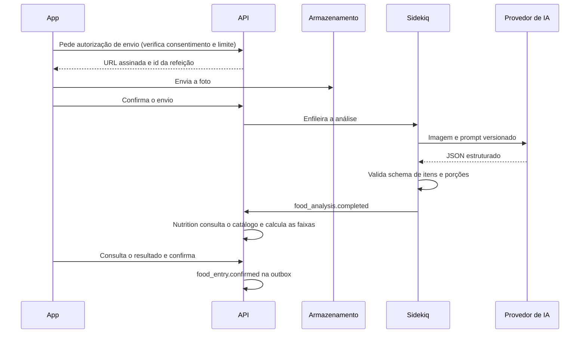
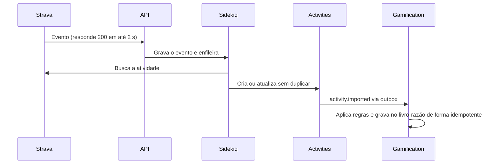

# Visão geral do sistema

Descreve a arquitetura pretendida. **Nada disto existe ainda em código.** Versões e ferramentas são confirmadas na Fase 01 ([ADR 0002](decisions/0002-technology-baseline.md)).

## Decisão central

Um **monólito modular em Rails**, com domínios separados por namespace, atendendo dois clientes. Um único desenvolvedor mantém tudo, então cada parte móvel a mais custa caro ([ADR 0001](decisions/0001-modular-monolith-monorepo.md)).



## Monorepo

```text
apps/api          Rails API: toda a regra de negócio
apps/web          Painel React
apps/mobile       App Expo
packages/contracts  OpenAPI e tipos gerados, se a Fase 01 justificar (ADR 0014)
docs/             Documentação e planejamento
scripts/          Verificações do harness e automações
docker/           Imagens e configuração de containers (a partir da Fase 01)
.claude/          Rules, agents e skills do projeto
```

O verificador falha se `apps/`, `packages/` ou `docker-compose.yml` existirem antes do início da Fase 01. Pastas `apps/` e `packages/` geradas por ferramentas existem no repositório desde 2026-11-05, fora do processo do harness e sem código de negócio. O responsável decidiu mantê-las. Com a Fase 01 em `Não iniciada`, o check `scope` do verificador reprova por causa delas. Veja a [Fase 01](../roadmap/phases/PHASE_01_FOUNDATION.md).

## Responsabilidades

| Parte | Faz | Não faz |
|---|---|---|
| `apps/api` | Regra de negócio, autorização, persistência, jobs, integrações | Renderizar telas |
| `apps/web` e `apps/mobile` | Apresentação, estado de tela, validação de formulário para dar retorno rápido | Decidir regra de negócio, calcular XP, nutrição ou conclusão de meta |
| `packages/contracts` | Fonte dos contratos da API e tipos gerados | Conter lógica |

O backend é a fonte central da lógica. Se os dois clientes precisam calcular a mesma coisa, ela pertence à API.

## Fluxos principais

### Foto até o registro da refeição



Detalhes em [AI_ARCHITECTURE.md](AI_ARCHITECTURE.md).

### Webhook do Strava até o XP



Detalhes em [STRAVA_INTEGRATION.md](STRAVA_INTEGRATION.md) e [GAMIFICATION_ARCHITECTURE.md](GAMIFICATION_ARCHITECTURE.md).

## Atributos de qualidade e como a arquitetura responde

| Atributo | Resposta |
|---|---|
| Simplicidade para um desenvolvedor | Um deploy, um banco, um processo de jobs |
| Evolução dos domínios | Limites por namespace, comunicação por eventos, regras verificadas em teste ([ADR 0003](decisions/0003-domain-boundaries-without-engines.md)) |
| Consistência entre domínios | Outbox transacional e consumidores idempotentes ([ADR 0004](decisions/0004-domain-events-transactional-outbox.md)) |
| Troca de provedores | Adaptadores para IA e bases nutricionais ([ADR 0006](decisions/0006-food-ai-pipeline-and-provider-abstraction.md), [ADR 0007](decisions/0007-nutrition-data-sources.md)) |
| Privacidade | Consentimento por finalidade, armazenamento privado, cifragem, retenção automática ([PRIVACY_AND_LGPD.md](../security/PRIVACY_AND_LGPD.md)) |
| Crescimento | Sidekiq e Rails escalam horizontalmente. Um domínio só vira serviço com evidência real de necessidade |

## O que deliberadamente não existe

- **Microsserviços:** nenhum domínio tem hoje uma necessidade de escala ou de equipe que justifique.
- **Rails Engine por domínio:** o custo de configuração não se paga sem uma justificativa concreta.
- **GraphQL:** REST com OpenAPI atende aos dois clientes.
- **Broker de eventos externo:** a outbox com Sidekiq basta enquanto há um único processo produtor e consumidor.
- **Lógica de negócio nos clientes:** ver a tabela de responsabilidades.

Mudar qualquer um destes itens exige uma nova ADR.
