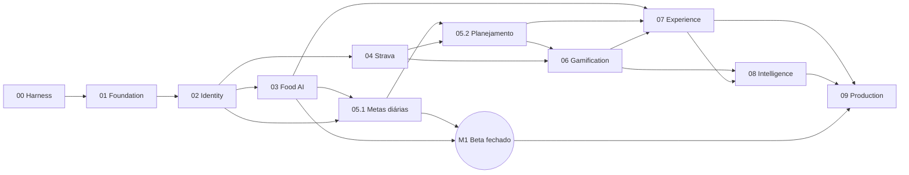

# Roadmap

Estado atual em [STATUS.md](STATUS.md). Como executar em [PHASE_EXECUTION_PROTOCOL.md](PHASE_EXECUTION_PROTOCOL.md). **Nenhuma fase começa sem autorização do responsável,** mesmo que a anterior tenha sido concluída.

## Fases

| Linha | Nome | Depende de | Critério de aceite resumido | Documento |
|---|---|---|---|---|
| 00 | Engineering Harness | Nenhuma | Uma sessão nova entende como desenvolver lendo o harness | [Fase 00](phases/PHASE_00_HARNESS.md) |
| 01 | Foundation & DX | 00 | Aplicações sobem localmente, os serviços se comunicam e o CI faz verificações reais | [Fase 01](phases/PHASE_01_FOUNDATION.md) |
| 02 | Identity, Security & Privacy | 01 | Cada pessoa acessa só os próprios dados, com fluxos de privacidade testados | [Fase 02](phases/PHASE_02_IDENTITY_SECURITY.md) |
| 03 | Food AI | 02 | Uma foto percorre o pipeline, gera estimativa estruturada, e pode ser registrada e corrigida | [Fase 03](phases/PHASE_03_FOOD_AI.md) |
| 04 | Strava Integration | 02 | Atividades importadas sem duplicar, com todo o ciclo de vida da integração | [Fase 04](phases/PHASE_04_STRAVA.md) |
| 05.1 | Goals: metas diárias | 02; 03 para metas de refeição | Metas de hábito com check-in manual e regras reproduzíveis | [Fase 05](phases/PHASE_05_GOALS.md) |
| 05.2 | Goals: planejamento e atividades | 05.1, 04 | Planejamento semanal, confirmação por atividades e recuperação | [Fase 05](phases/PHASE_05_GOALS.md) |
| 06 | Gamification Engine | 04, 05.1, 05.2 | Eventos geram progressão auditável, sem concessão duplicada | [Fase 06](phases/PHASE_06_GAMIFICATION.md) |
| 07 | Mobile & Web Experience | 03, 04, 05.2, 06 | Fluxos principais funcionam de ponta a ponta nas duas plataformas | [Fase 07](phases/PHASE_07_APPLICATIONS.md) |
| 08 | Intelligence & Personalization | 06, 07 | Insights baseados em dados reais, explicáveis e sem inferência indevida | [Fase 08](phases/PHASE_08_INTELLIGENCE.md) |
| 09 | Production Readiness & Launch | 07, 08, M1 | Evidências de qualidade, segurança, disponibilidade e operação | [Fase 09](phases/PHASE_09_PRODUCTION.md) |
| M1 | Beta fechado | 01, 02, 03, 05.1 | Até 10 pessoas usam foto e metas em ambiente real, com privacidade e operação comprovadas | [Marco M1](phases/MILESTONE_M1_CLOSED_BETA.md) |

## Dependências

## Ordem sugerida

`00 → 01 → 02 → 03 → 05.1 → M1 → 04 → 05.2 → 06 → 07 → 08 → 09`

**Por que o beta vem antes do Strava:** o primeiro entregável é a foto com estimativa e as metas diárias, e não depende do Strava. Ter gente usando mais cedo reduz o risco de produto e de monetização ([ADR 0016](../architecture/decisions/0016-closed-beta-milestone.md)). Além disso, o Strava limita apps novos a 10 atletas sem revisão.

O retorno do beta pode mudar a ordem das fases seguintes, por decisão do responsável.

## Entregas verticais

As telas acompanham cada fase, e a Fase 07 consolida a experiência:

| Fase | Telas |
|---|---|
| 02 | Cadastro, entrada, consentimentos, perfil, privacidade |
| 03 | Câmera, resultado, correção, histórico |
| 04 | Conexão com o Strava, atividades |
| 05 | Metas e check-in |
| 06 | XP, missões, conquistas |
| 07 | Painel web, consistência visual, acessibilidade |
| 08 | Relatórios, insights e notificações |

## Fora do roadmap

| Item | Registro |
|---|---|
| Ranking por esporte | [ADR 0013](../architecture/decisions/0013-sport-ranking.md) |
| Meta de calorias | [ADR 0011](../architecture/decisions/0011-no-calorie-goals.md), reavaliação após o M1 |
| Fase de cobrança | [ADR 0012](../architecture/decisions/0012-monetization-options.md), proposta após o M1 |
| Modo adolescente | [ADR 0010](../architecture/decisions/0010-adults-only-mvp-and-consent.md) |

## Pendências externas com impacto no cronograma

| Pendência | Bloqueia | Responsável |
|---|---|---|
| Autorização da TBCA | Melhor qualidade na Fase 03; não bloqueia o caminho alternativo | Responsável |
| Revisão jurídica | M1 | Responsável, com advogado |
| Assinatura e aplicação do Strava | 04 | Responsável |
| Revisão do Strava, acima de 10 atletas | Escala da Fase 04 | Responsável |
| Revisão de textos por profissional de saúde | 09 | Responsável |
| Definir a marca | 09 | Responsável |
